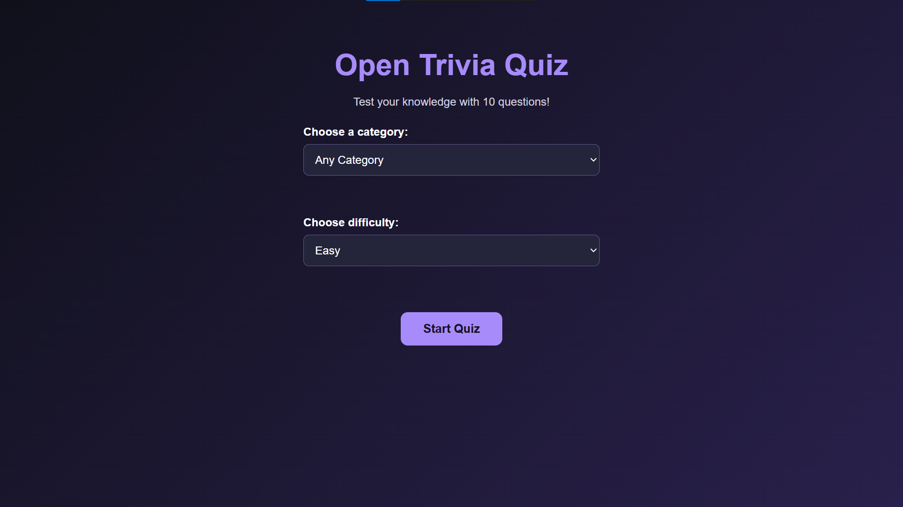
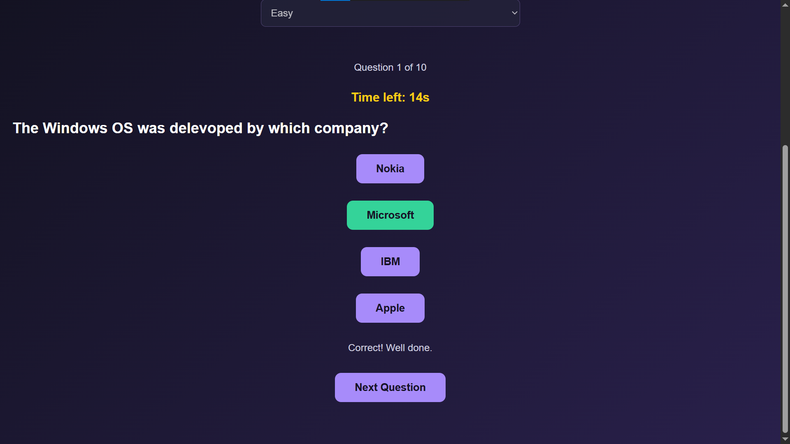

# Open Trivia Quiz

An interactive trivia quiz built using HTML, CSS, JavaScript, and the Open Trivia Database API.

## Screenshots

### Home Screen

### Quiz Question

## Features

- Multiple trivia categories
- Difficulty selection
- 10 questions per quiz
- Countdown timer
- Instant feedback for answers
- Score tracking
- Review of incorrect answers
- High-score saving using localStorage
- Responsive interface
- Play Again option

## Technologies Used

- HTML5
- CSS3
- JavaScript
- Open Trivia Database API
- Browser localStorage

## Live Demo

https://niketmulani24-creator.github.io/open-trivia-quiz/

## How to Run Locally

1. Download or clone this repository.
2. Open `index.html` in your browser.
3. Choose a category and difficulty.
4. Click **Start Quiz** and enjoy!

## Author

Niket Mulani
